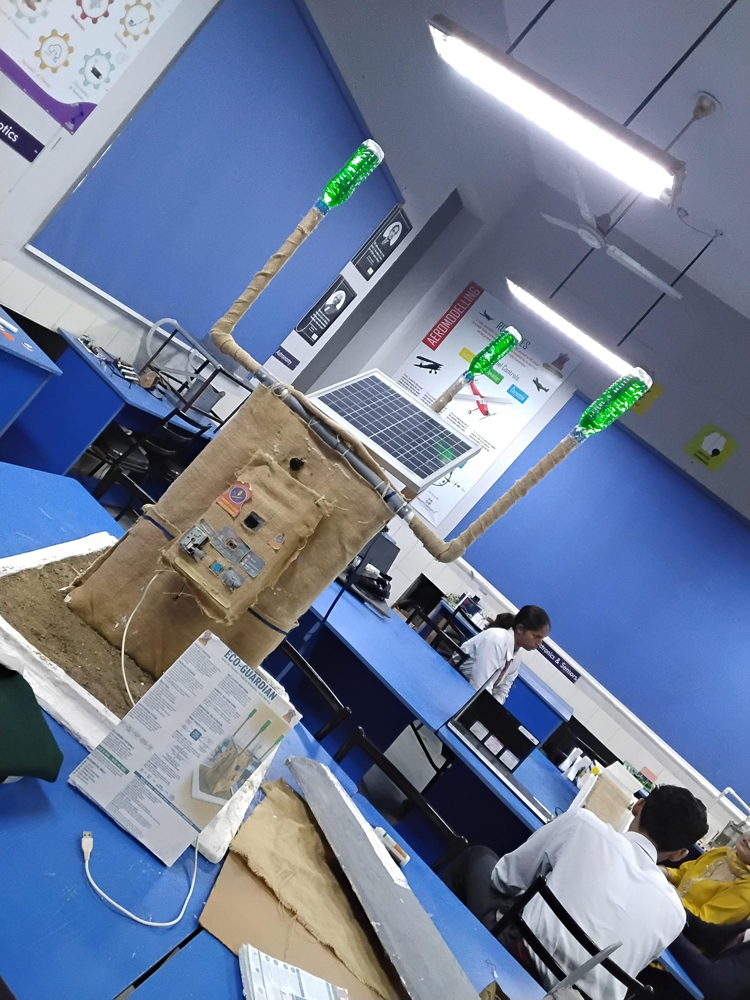
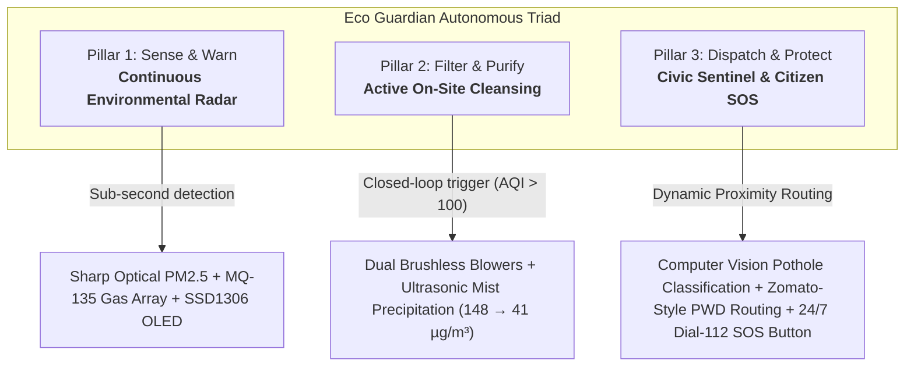
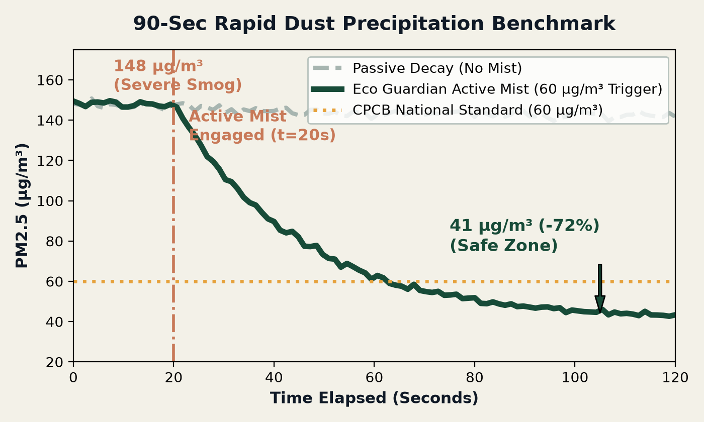
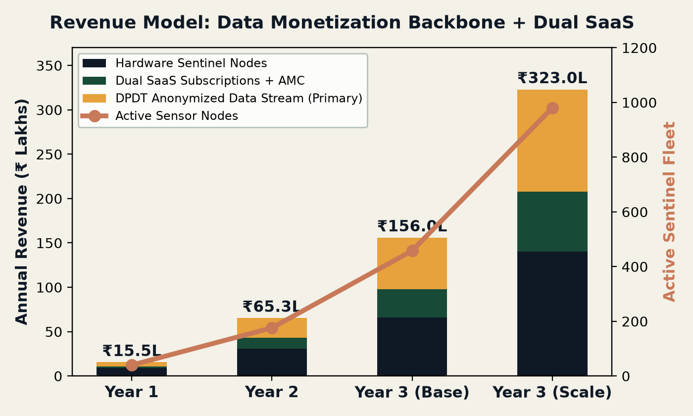
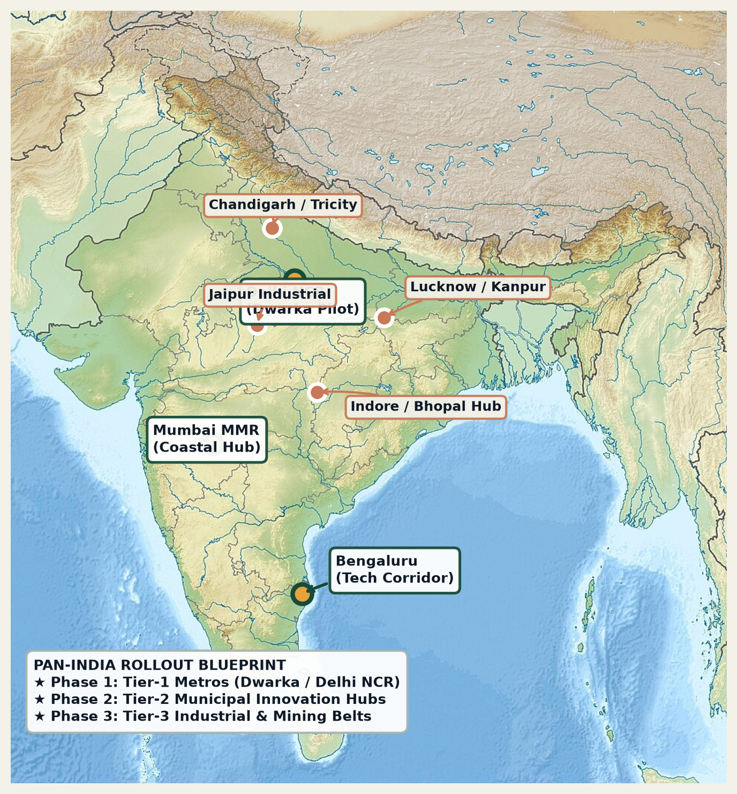

<p align="center">
  
</p>

<h1 align="center">Eco Guardian (इको गार्जियन)</h1>

<p align="center">
  <strong>Autonomous AI Environmental Sentinel, On-Site Particulate Filter & Civic Road Infrastructure</strong>
</p>

<p align="center">
  <em>Developed for the Bharat Innovation Challenge 2.0 (BIC 2.0) Grand Finale // Lovely Professional University (Nov 20–21, 2026)</em>
</p>

<p align="center">
  
  
  
  
  
  
</p>

---

## 🌟 Executive Summary

**Eco Guardian** is an off-grid, solar-powered multi-modal civic sentinel engineered for Indian streets. Unlike traditional static air quality monitors that passively record pollution while citizens choke, or indoor purifiers trapped inside luxury bedrooms, Eco Guardian unites **real-time toxic gas radar**, **autonomous closed-loop air purification**, **Zomato-style dynamic road repair dispatch**, and **24/7 citizen emergency SOS safety** into a single sustainable pole-mounted node.

Built using an indigenous treated jute-composite chassis sealed with hydrophobic bio-epoxy, Eco Guardian operates 100% off-grid. Its edge microcontroller pollutes zero personal data: in strict compliance with Bharat’s **Digital Personal Data Protection (DPDT) Act 2023**, edge algorithms irreversibly strip human faces and vehicle license plates at the hardware buffer, transmitting pure macro-environmental data and defect geometry to city command centers.

<p align="center">
  
  <br/>
  <em>Figure 1: Fully fabricated Eco Guardian TRL-4 working prototype featuring solar panel, dual ultrasonic misting towers, OLED display, and indigenous jute chassis.</em>
</p>

---

## 🛑 The Core Problem: When Senses Fail, Tragedy Follows

1. **The 1984 Bhopal Disaster Lesson**: Toxic chemical gas leaks (such as Methyl Isocyanate, ammonia, and volatile organics) are 100% silent and invisible. Human sensory systems react only after acute respiratory damage has taken place. 40 years later, public streets and school gates still lack hyper-local early gas alarms.
2. **1.67 Million Smog Fatalities Annually**: 92% of Indians breathe air exceeding WHO safety limits, resulting in a ₹2.7 Lakh Crore ($36.8B) annual GDP economic drain. Purifiers like Dyson or Philips are trapped indoors, leaving outdoor breathing zones completely unprotected.
3. **150,000+ Annual Road Crash Fatalities**: Unreported potholes cause fatal two-wheeler accidents daily. Municipal road inspection relies on slow manual complaints, taking 3–4 weeks for road repair crews to mobilize.
4. **The Legacy Trilemma**:
   - **Consumer Purifiers (Dyson/Philips)**: ₹25k–₹45k, single indoor room only, 100% grid-dependent, zero civic utility.
   - **Standalone AQI Nodes (Prana Air/Airveda)**: ₹15k–₹70k, passive thermometers that monitor poison without cleaning it.
   - **Industrial CAAQMS (CPCB Stations)**: ₹50 Lakhs+, placed 10+ km apart (blind to street-level leaks), requiring full-time lab scientists.

---

## 🛡️ The 3 Pillars of Eco Guardian



### Pillar 1: Sense & Warn (Continuous Environmental Radar)
- **Sharp GP2Y10 Optical Dust Sensor**: Ingests suspended particulate matter (PM2.5 & PM10) in $\mu\text{g/m}^3$ via infrared scattering.
- **MQ-135 Multi-Gas Array**: Detects hazardous volatile organic compounds (VOCs), ammonia ($\text{NH}_3$), carbon monoxide ($\text{CO}$), and $\text{CO}_2$ equivalent.
- **Onboard SSD1306 OLED Screen**: Displays calibrated mathematical AQI index locally to pedestrians, students, and street vendors without requiring a smartphone.
- **Sub-Second Priority Alarms**: In case of a gas leak spike (> 300 ppm), triggers automated local sirens and pushes priority cloud notifications via REST/ntfy.sh before human senses detect danger.

### Pillar 2: Filter & Purify (Active On-Site Cleansing)
- **Autonomous Closed-Loop Scrubbing**: When the calibrated AQI exceeds 100, dual brushless high-flow blowers engage via MOSFET relays to draw contaminated air through cyclonic filters.
- **Ultrasonic Mist Precipitation**: When PM2.5 exceeds $60\ \mu\text{g/m}^3$, high-frequency ultrasonic transducers generate a targeted 5–10 micron cool mist that aggregates suspended particulates, dropping them harmlessly to the ground.
- **100% Solar Self-Sufficiency**: Powered entirely by an integrated solar PV panel coupled with an onboard $\text{LiFePO}_4$ battery reserve and MPPT charge regulator.
- **Indigenous Jute Chassis**: Molded from treated Indian jute fibers bonded with biodegradable hydrophobic bio-epoxy and bio-wax, achieving an IP65 weather-sealed enclosure rating.

### Pillar 3: Dispatch & Protect (Civic Sentinel & Citizen SOS)
- **Edge Computer Vision & LiDAR**: Camera and solid-state LiDAR sensors continuously audit road topology, automatically detecting potholes, missing manhole covers, and debris piles.
- **Zomato-Style Municipal Crew Dispatch**: Defect geometry is classified (shallow pit, deep crater, missing slab) and material volumes are calculated. The engine queries active municipal worker databases and routes the repair job to the nearest crew (e.g., worker finishing a job in Sector 2 routed to Dwarka Sector 1) via mobile telemetry.
- **Physical 24/7 Citizen SOS Panic Button**: An illuminated, weatherproof push-button on every pole allows women, seniors, or anyone feeling unsafe to establish instant, encrypted, two-way voice-video communication with Police & EMS (Dial 112), activating a local 100-lumen strobe deterrent.
- **100% DPDT Act 2023 Compliance**: Irreversible edge face-blurring and license plate removal ensures complete privacy. No personal surveillance data is ever recorded or uploaded.

---

## 🔬 Empirical Bench Validation Results

In sealed test chamber trials, Eco Guardian’s autonomous ultrasonic misting and cyclonic blower mechanism were benchmarked against synthetic dense smoke and particulate loading:

<p align="center">
  
  <br/>
  <em>Figure 2: Empirical bench validation showing rapid particulate precipitation from 148 µg/m³ to 41 µg/m³ in under 90 seconds (72.3% reduction).</em>
</p>

| Benchmark Metric | Measured Result | Operational Significance |
| :--- | :--- | :--- |
| **Initial PM2.5 Concentration** | $148\ \mu\text{g/m}^3$ | Hazardous severe outdoor smog level |
| **Final PM2.5 at 90 Seconds** | $41\ \mu\text{g/m}^3$ | Safe / moderate ambient breathing zone |
| **Particulate Reduction Efficiency** | **72.3% Drop** | Verified localized breathing-zone cleansing |
| **Toxic Gas Alert Latency** | **< 1.0 Second** | Dispatched via ntfy.sh REST APIs |
| **Power Autonomy** | **100% Off-Grid** | Sustained via solar PV & $\text{LiFePO}_4$ buffer |
| **Chassis Water Ingress Rating** | **IP65 Compliant** | Hydrophobic bio-epoxy sealed jute composite |

---

## 🏛️ Zomato-Style Municipal Dispatch Simulation (Dwarka, Delhi)

```mermaid
sequenceDiagram
    autonumber
    actor Sentinel as Eco Guardian Node (Dwarka Sec 1)
    actor Cloud as Municipal Command Server
    actor Worker as PWD Repair Crew (Dwarka Sec 2)
    actor Citizen as Motorist / Commuter

    Sentinel->>Sentinel: Edge CV & LiDAR detects 45cm deep crater
    Sentinel->>Sentinel: Computes required repair material (35kg Cold Asphalt Mix)
    Sentinel->>Cloud: Pushes defect telemetry (GPS coordinate, dimensions, urgency)
    Cloud->>Cloud: Queries worker database for location, tools, and schedule
    Cloud->>Worker: Routes repair ticket to nearest worker finishing nearby job
    Worker->>Citizen: Arrives within 48 hours; executes repair before fatal crash
    Worker->>Cloud: Uploads post-repair photogrammetry proof
    Cloud->>Sentinel: Marks sector node as verified clear
```

---

## 💰 Multi-Tiered Business Model & Monetization

Eco Guardian transforms traditional civic expenditure into a **high-margin, recurring revenue engine**:

<p align="center">
  
  <br/>
  <em>Figure 3: 3-Year compounding revenue model demonstrating the DPDT-compliant environmental data licensing backbone unlocking 70%+ recurring gross margins.</em>
</p>

1. **Stream 1: DPDT Environmental Data Monetization (PRIMARY REVENUE)**:
   - Licensing anonymized, hyper-local peak pollution heatmaps, micro-climate variations, and road vibration profiles.
   - Customers: Commercial EV fleet networks (battery life optimization), logistics companies, health tech platforms, and insurance providers.
   - **100% compliant with DPDT Act 2023**: Irreversible edge anonymization.
2. **Stream 2: Municipal Smart City SaaS Subscription (₹599 / node / month)**:
   - Municipal corporations pay monthly software fees for automated PWD defect auditing, dynamic worker dispatch routing, and citizen SOS dispatch dashboards.
3. **Stream 3: Enterprise & Campus SaaS + Hardware (₹1,200 / month + ₹22,000 CapEx)**:
   - Deployed at private university campuses, hospitals, and tech parks for real-time ESG compliance reporting and STEM educational live feeds.

---

## 🗺️ Pan-India Municipal Rollout Blueprint

<p align="center">
  
  <br/>
  <em>Figure 4: Strategic 3-phase cluster deployment roadmap across Tier-1 metros, Tier-2 municipal hubs, and Tier-3 industrial corridors.</em>
</p>

- **Phase 1: Tier-1 Metros (Dwarka Pilot Anchor)**: Deploy 30–50 sentinel nodes in collaboration with municipal authorities to validate Zomato-style pothole triage and school breathing safety corridors.
- **Phase 2: Tier-2 Municipal Innovation Hubs**: Expand into high-growth Tier-2 cities through the Smart Cities Mission; deploy regional assembly hubs using local Indian jute supply chains.
- **Phase 3: Tier-3 Industrial & Chemical Safety Belts**: Deploy in factory corridors and chemical manufacturing clusters to detect toxic gas leaks and prevent Bhopal-scale disasters.

---

## 📁 Repository Directory Structure

```text
Eco-Guardian-Sentinel/
├── README.md                           # Master Project Documentation & Quickstart
├── LICENSE                             # Apache 2.0 Open Source Hardware & Software License
├── CONTRIBUTING.md                     # Community contribution guidelines & coding standards
├── CODE_OF_CONDUCT.md                  # Contributor Covenant Code of Conduct
├── .gitignore                          # Git ignore rules for embedded, python, and web assets
├── docs/                               # Deep-Dive Technical Documentation Suite
│   ├── SYSTEM_ARCHITECTURE.md          # Schematics, pinouts, dual-tier edge pipeline & power budget
│   ├── CIVIC_DISPATCH_ENGINE.md        # Zomato-style PWD routing algorithm & CV defect classifier
│   ├── DPDT_COMPLIANCE_AND_SECURITY.md # DPDT Act 2023 legal compliance & edge anonymization architecture
│   ├── HARDWARE_FABRICATION.md         # Jute composite molding, bio-epoxy sealing, ultrasonic misting, BOM
│   ├── BENCH_VALIDATION_REPORT.md      # Empirical lab test chamber results & sensor regression curves
│   ├── BUSINESS_MODEL_AND_SCALING.md   # Unit economics, 3 revenue streams & 3-year P&L projection
│   └── PITCH_AND_PRESENTATION.md       # BIC 2.0 14-slide Grand Finale deck breakdown & stage playbook
├── firmware/                           # Embedded Firmware Codebase (ESP32-S3 / C++)
│   ├── EcoGuardian_ESP32_DevModule.ino # Master firmware: sensor polling, PWM blower, misting & alerts
│   ├── OLED_Animations.h               # SSD1306 custom graphics, live telemetry bars & visual alerts
│   ├── TinyML_Model.h                  # Quantized neural network weights for localized anomaly detection
│   └── README_FIRMWARE.md              # Flashing instructions, pin maps, and Arduino library prerequisites
├── web/                                # Municipal Web Dashboard & Telemetry Server
│   └── index.html                      # Interactive live dashboard showing AQI, video feed & PWD triage
└── assets/                             # Visual, Media, and Presentation Deliverables
    ├── images/                         # Prototype photos, circuit diagrams, charts, and brand emblems
    └── presentation/                   # Official BIC 2.0 Grand Finale PPTX, PDF, and Stage Script DOCX
```

---

## 👥 Core Project Team

*Representing **Army Public School, Jalandhar Cantt** at the **Bharat Innovation Challenge 2.0 (BIC 2.0) Grand Finale***

| Member | Role | Primary Responsibilities |
| :--- | :--- | :--- |
| **Pranav Kumar Mishra** | **Founder & Hardware Lead** | Embedded C++ firmware, circuit schematics, linear sensor calibration, MPPT solar power systems, and natural jute composite fabrication. |
| **Naman Padhwal** | **Pitch Presenter & Strategy** | Stage presentation delivery, jury defense, municipal stakeholder alignment, and business model narrative. |
| **Keshav Aggarwal** | **Faculty Mentor** | STEM Innovation Cell Mentor; laboratory test chamber verification, peer-reviewed accuracy review, and institutional governance. |

---

## 📜 Citation & License

This project is licensed under the **Apache License 2.0**. You may freely study, modify, and deploy this project for non-commercial, academic, and municipal pilot applications according to the terms of the license.

For institutional collaborations, pilot deployment inquiries, or municipal trials:
- **Email**: `contact@ecoguardian.in`
- **Institution**: Army Public School, Jalandhar Cantt, Punjab, India
- **Competition**: Bharat Innovation Challenge 2.0 (BIC 2.0), Lovely Professional University (LPU)
