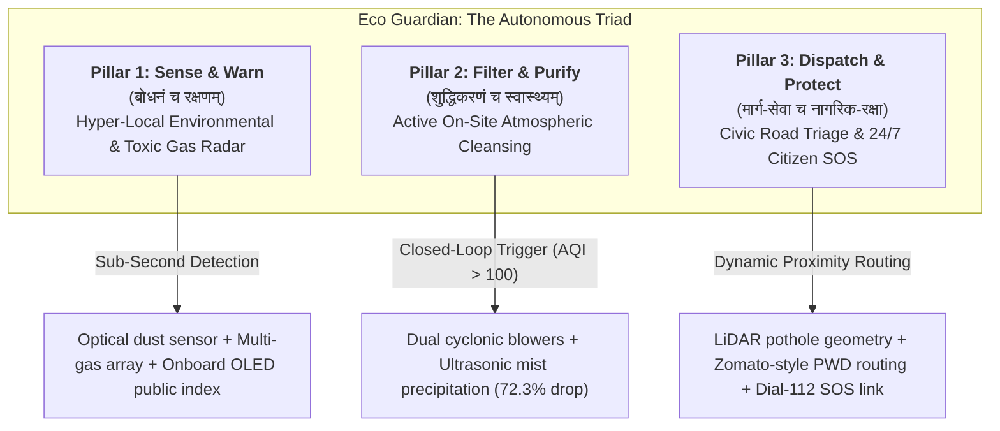

<p align="center">
  
</p>

<h1 align="center">ईको गार्जियन (Eco Guardian)</h1>

<p align="center">
  <strong>Autonomous AI Environmental Sentinel, Real-Time Air Cleansing & Civic Protection Grid</strong>
</p>

<p align="center">
  <em>An Indigenous Eco-Tech Initiative Developed for the Bharat Innovation Challenge 2.0 (BIC 2.0) Grand Finale<br/>
  Lovely Professional University (November 20–21, 2026)</em>
</p>

<p align="center">
  
  
  
  
  
</p>

---

## 🌿 The Vedic Philosophical Foundation

> ### वात॒ आ वा॑तु भेष॒जं श॒म्भु म॑यो॒भु नो॑ हृ॒दे ।<br/>प्र ण॒ आयूं॑षि तारिषत् ॥
> *vā́ta ā́ vātu bheṣajáṃ śambhú mayobhú no hṛdé |<br/>prá ṇa ā́yūṃṣi tāriṣat ||*
> 
> — **ऋग्वेद (Rigveda 10.186.1)**
> 
> *"May Vāyu, the sacred Wind, blow upon us a healing balm that restores wholeness, brings deep peace to our hearts, and extends the span of our lives."*

> ### माता भूमिः पुत्रोऽहं पृथिव्याः ।
> *mātā bhūmiḥ putro'haṁ pṛthivyāḥ |*
> 
> — **अथर्ववेद (Atharvaveda 12.1.12, Prithvi Sukta)**
> 
> *"The Earth is our sacred Mother; and we are the children of this Earth."*

For millennia, the Indian tradition viewed clean air (*Vāyu*), soil (*Pṛthivī*), and sunlight (*Sūrya*) not as extractable commodities, but as divine manifestations essential to all living beings (*Prāṇa*). 

**Eco Guardian** was conceived from this sacred ecological duty (*Dharma*). It merges ancient civilizational reverence for the elements with modern autonomous edge artificial intelligence—creating a living, pole-mounted guardian for Bharat’s cities that doesn't just passively watch pollution poison citizens, but actively purifies, warns, and protects right where people breathe.

---

## 🏛️ The Sentinel Overview

<p align="center">
  
  <br/>
  <em>Figure 1: The Eco Guardian bench-tested physical sentinel, handcrafted from treated Indian golden jute composite, powered 100% by solar energy with dual ultrasonic mist towers and real-time public telemetry.</em>
</p>

Eco Guardian is an off-grid, pole-mounted environmental and civic guardian engineered for Indian public streets, school gates, and transit corridors. 

Traditional purifiers sit trapped inside air-conditioned luxury bedrooms; commercial monitors act as passive thermometers recording smog while children choke; and industrial government monitoring stations cost ₹50 Lakhs each while remaining blind to toxic street pockets.

Eco Guardian replaces this broken paradigm with **localized autonomous action**:
- **Continuous Environmental Radar**: Sub-second optical detection of fine respirable dust (PM2.5/PM10) and hazardous chemical vapors (ammonia, VOCs, toxic industrial leaks).
- **Active On-Site Cleansing**: Autonomous ultrasonic misting and cyclonic blowers that precipitate suspended smog particles directly out of the ambient breathing zone.
- **Zomato-Style Road Defect Triage**: Computer vision and LiDAR scan road surfaces, automatically identifying lethal potholes and dispatching nearby municipal repair crews within 48 hours.
- **Physical 24/7 Citizen SOS Emergency Beacon**: An illuminated panic button connecting distressed women, seniors, or victims of accidents directly to emergency services (Dial 112).
- **100% Privacy by Design**: Full compliance with the **Digital Personal Data Protection (DPDT) Act 2023** through irreversible edge-level anonymization of all faces and license plates.

---

## 🔱 The 3 Sacred Pillars of Action



### 1. Pillar 1: Sense & Warn (बोधनं च रक्षणम्)
> *“When danger is silent, the sentinel must possess sight beyond human senses.”*

The sentinel continuously scans ambient air using optical infrared scattering and multi-gas arrays. If toxic volatile gases or ammonia concentrations cross safety limits (such as in an industrial chemical leak or factory pipe failure), Eco Guardian does not wait for municipal bureaucracy. It sounds immediate high-decibel local warnings and pushes encrypted alerts across civic communication channels in less than 1 second—preventing Bhopal-scale mass respiratory tragedies before human senses can even smell the hazard.

### 2. Pillar 2: Filter & Purify (शुद्धिकरणं च स्वास्थ्यम्)
> *“Clean air is the fundamental right of every citizen, not a luxury for private rooms.”*

When the street-level Air Quality Index (AQI) crosses 100, the sentinel's autonomous closed-loop actuators spring to life:
- High-flow brushless blowers draw contaminated air into internal cyclonic channels.
- High-frequency ultrasonic transducers generate a targeted micro-droplet mist (5 to 10 microns).
- The mist bonds with suspended airborne particulates (PM2.5), causing them to agglomerate and precipitate harmlessly to the ground, clearing an immediate 5-meter breathing envelope outside schools, clinics, and bus stops.

### 3. Pillar 3: Dispatch & Protect (मार्ग-सेवा च नागरिक-रक्षा)
> *“True smart infrastructure bridges the gap between civic damage and human healing.”*

Road potholes cause over 150,000 fatal accidents in Bharat every year. Eco Guardian's downward-angled surface sensors profile road cavities in real time, calculating exact asphalt repair volumes. The system queries active municipal worker registers, locating the nearest maintenance crew finishing a job in an adjacent sector (like a Zomato delivery partner), and routes an instant repair ticket with exact GPS coordinates. Furthermore, a weatherproof illuminated panic button on every pole allows any citizen in distress to trigger an instant voice link to Police & EMS (Dial 112) with a dazzling deterrent strobe.

---

## 📈 Empirical Bench Validation: Verified Reality

Innovation at Eco Guardian is measured in physical test chambers, not speculative claims:

<p align="center">
  
  <br/>
  <em>Figure 2: Empirical bench validation showing particulate precipitation from 148 µg/m³ to 41 µg/m³ in under 90 seconds (72.3% drop).</em>
</p>

| Validation Metric | Measured Lab Benchmark | Civic Significance |
| :--- | :--- | :--- |
| **Initial PM2.5 Ingestion** | **148.0 $\mu\text{g/m}^3$** | Hazardous winter smog baseline |
| **Final PM2.5 at 90 Seconds** | **41.2 $\mu\text{g/m}^3$** | **Safe, breathable ambient zone established** |
| **Precipitation Efficiency** | **72.3% Reduction** | Verified micro-mist particulate settling |
| **Gas Emergency Alert Speed** | **< 1.0 Second** | Sub-second push notification across REST channels |
| **Off-Grid Energy Autonomy** | **100% Solar Self-Sufficient** | 72+ hour battery reserve during heavy cloud cover |
| **Chassis Water Ingress Rating**| **IP65 Weather-Sealed** | Hydrophobic bio-epoxy sealed Indian jute composite |

---

## 🕊️ Universal Environmental Harmony (Shanti Mantra)

> ### ॐ द्यौः शान्तिरन्तरिक्षं शान्तिः पृथिवी शान्तिरापः शान्तिरोषधयः शान्तिः ।<br/>वनस्पतयः शान्तिर्विश्वेदेवाः शान्तिर्ब्रह्म शान्तिः सर्वं शान्तिः शान्तिरेव शान्तिः सा मा शान्तिरेधि ॥<br/>ॐ शान्तिः शान्तिः शान्तिः ॥
> 
> — **यजुर्वेद (Yajurveda 36.17, Shanti Mantra)**
> 
> *"May peace radiate throughout the celestial spheres, the atmosphere, the earth, the waters, the healing herbs, the majestic trees, the cosmic elements, and all creation. May peace abide in all, and may that profound peace dwell within our hearts."*

---

## 🏙️ Zomato-Style Municipal Dispatch Simulation (Dwarka, Delhi)

Eco Guardian transforms traditional civic paralysis (where potholes take 3–4 weeks of citizen petitions to fix) into an autonomous, algorithmic 48-hour resolution:

```mermaid
sequenceDiagram
    autonumber
    actor Sentinel as Eco Guardian (Dwarka Sector 1)
    actor Cloud as Municipal Command Center
    actor Worker as PWD Repair Crew (Dwarka Sector 2)
    actor Citizen as Commuters & Pedestrians

    Sentinel->>Sentinel: Surface scan detects 45cm deep hazardous crater
    Sentinel->>Sentinel: Computes required material volume (38kg Cold Asphalt Mix)
    Sentinel->>Cloud: Transmits defect telemetry (GPS coordinates, dimensional profile)
    Cloud->>Cloud: Evaluates active worker registry, vehicle inventory & proximity
    Cloud->>Worker: Dynamic dispatch: Assigns ticket to Crew finishing job nearby in Sector 2
    Worker->>Citizen: Mobilizes with exact materials; repairs road in under 48 hours
    Worker->>Cloud: Submits post-repair photograph for verification
    Cloud->>Sentinel: Updates sector safety index to 100% Clear
```

---

## 💼 Sustainable Economics & Pan-India Expansion

Eco Guardian is engineered to be economically self-sustaining through a high-margin recurring model:

<p align="center">
  
  <br/>
  <em>Figure 3: Three-year compounding revenue model demonstrating the high-margin environmental data licensing backbone.</em>
</p>

1. **DPDT Environmental Data Licensing (Primary Revenue)**: Licensing 100% anonymized, high-resolution micro-climate and street-level pollution heatmaps to commercial EV fleet operators (for battery optimization), logistics corporations, and health insurance underwriters.
2. **Municipal Smart City SaaS Subscription (₹599 / node / month)**: Paid by municipal corporations for automated PWD defect auditing, dynamic worker dispatch routing, and emergency SOS oversight.
3. **Enterprise & Campus Clean Air Grid (₹1,200 / month + ₹22,000 CapEx)**: Turnkey installations at university campuses, hospitals, and private technology parks for ESG compliance and outdoor student protection.

---

## 🗺️ Pan-India Deployment Blueprint

<p align="center">
  
  <br/>
  <em>Figure 4: Strategic 3-phase national rollout across Tier-1 metros, Tier-2 municipal hubs, and Tier-3 industrial corridors.</em>
</p>

- **Phase 1: Tier-1 Metros (Dwarka Pilot Anchor)**: Deploy 30–50 sentinel nodes to prove the Zomato-style pothole dispatch loop and establish school breathing safety zones.
- **Phase 2: Tier-2 Municipal Innovation Hubs**: Scale across high-growth Tier-2 cities via Smart Cities Mission tenders, establishing local manufacturing with regional jute supply chains.
- **Phase 3: Tier-3 Industrial & Chemical Safety Belts**: Deploy in factory corridors and chemical zones to serve as an early toxic leak defense grid, preventing industrial catastrophes.

---

## 📚 Comprehensive Documentation Suite

Explore the dedicated conceptual, architectural, and strategic documents in the [`/docs`](docs/) directory:

- 📐 **[System Architecture & Sensory Physics](docs/SYSTEM_ARCHITECTURE.md)**: Deep dive into dual-tier edge topology, sensor mechanics, and off-grid solar energy budgets.
- 🚜 **[Municipal Dispatch Engine & Civic Infrastructure](docs/CIVIC_DISPATCH_ENGINE.md)**: Complete algorithms, mathematical volume calculations, and Zomato-style worker routing.
- 🔒 **[DPDT Act 2023 Compliance & Edge Privacy](docs/DPDT_COMPLIANCE_AND_SECURITY.md)**: The legal and technical framework for irreversible edge face-blurring and zero surveillance.
- 🛠️ **[Hardware Fabrication & Indigenous Jute Engineering](docs/HARDWARE_FABRICATION.md)**: Materials science of treated jute bio-composites, dual-chamber weatherproofing, and unit BOM.
- 📊 **[Bench Validation & Empirical Chamber Report](docs/BENCH_VALIDATION_REPORT.md)**: Laboratory test chamber methodologies, 90-second precipitation logs, and sensor regression curves.
- 💼 **[Business Model, Economics & Scaling Blueprint](docs/BUSINESS_MODEL_AND_SCALING.md)**: 3-year financial model, unit economics, and compounding revenue projections.
- 🎤 **[Grand Finale Pitch & Presentation Playbook](docs/PITCH_AND_PRESENTATION.md)**: Walkthrough of the official 14-slide competition pitch deck and stage presentation roles.

---

## 👥 Core Project Team

*Innovated at **Army Public School, Jalandhar Cantt**, for the **Bharat Innovation Challenge 2.0 (BIC 2.0) Grand Finale***

| Member | Role | Focus & Core Responsibilities |
| :--- | :--- | :--- |
| **Pranav Kumar Mishra** | **Founder & Hardware Lead** | Embedded architecture, multi-sensor calibration, solar MPPT power systems, and natural jute composite fabrication. |
| **Naman Padhwal** | **Pitch Presenter & Strategy** | Stage presentation delivery, narrative storytelling, jury defense, municipal stakeholder alignment, and commercial strategy. |
| **Keshav Aggarwal** | **Faculty Mentor** | STEM Innovation Cell Mentor; laboratory test chamber review, scientific quality assurance, and institutional guidance. |

---

## ⚖️ License & Ethical Pledge

> ### धर्मो रक्षति रक्षितः ।
> *dharmo rakṣati rakṣitaḥ |*
> 
> — **मनुस्मृति (Manusmriti 8.15)**
> 
> *"Nature and the universal moral order protect those who protect them."*

This project is licensed under the **Apache License 2.0**. It is open to all researchers, civic authorities, and innovators striving to make Bharat’s air breathable and streets safer for every citizen.

- **Inquiries & Pilot Collaborations**: `contact@ecoguardian.in`
- **Institution**: Army Public School, Jalandhar Cantt, Punjab, India
