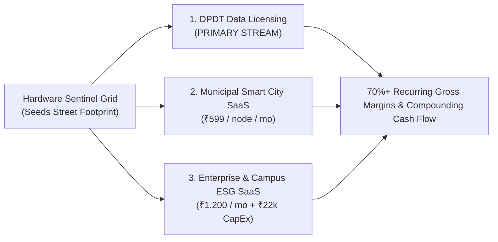

# 💼 Eco Guardian: Business Model, Financial Projections & Scaling Strategy

> ### सं गच्छध्वं सं वदध्वं सं वो मनांसि जानताम् ।<br/>देवा भागं यथा पूर्वे संजानाना उपासते ॥
> *saṁ gacchadhvaṁ saṁ vadadhvaṁ saṁ vo manāṁsi jānatām |<br/>devā bhāgaṁ yathā pūrve saṁjānānā upāsate ||*
> 
> — **ऋग्वेद (Rigveda 10.191.2, Sangathan Sukta)**
> 
> *"Walk together in harmony; speak together with one voice; let your minds move in noble accord, even as the illuminated divine forces in ancient times shared the sacred offerings in mutual reverence."*

---

## 1. Commercialization Paradigm: Hardware-Enabled Data & SaaS

Traditional environmental hardware companies suffer from lumpy one-time CapEx sales with low margins and high warranty liabilities. 

Eco Guardian operates on a **Hardware-Enabled Recurring Data Model**: hardware nodes seed the physical municipal footprint at near-cost, unlocking **high-margin, recurring software and data revenue**:



---

## 2. Three Diversified Revenue Streams

### Stream 1: DPDT Environmental Data Monetization (PRIMARY REVENUE)
- **What is sold**: 100% anonymized, high-resolution micro-climate heatmaps, street-level air toxicity vectors, road roughness indices (IRI), and localized solar irradiance logs.
- **Why buyers pay**:
  - **Commercial EV Fleets (BluSmart, Tata.ev)**: Ambient temperature and particulate density directly affect battery degradation rates and cabin air conditioning loads. Hyper-local heatmaps optimize charging schedules and route battery efficiency by up to 12%.
  - **Last-Mile Logistics (Delhivery, Porter, Blinkit)**: Real-time road damage and pothole data prevent vehicle suspension damage and reduce cargo breakage.
  - **Health & Life Insurers**: Ward-level respiratory risk metrics enable micro-insurance underwriting and actuarial risk modeling.
- **Pricing**: Tiered B2B subscriptions:
  - *Starter*: ₹30,000 / month (Regional Ward Access).
  - *Enterprise*: ₹1,20,000 / month (Metro-wide real-time live streaming feed).

### Stream 2: Municipal Smart City SaaS Subscription (₹599 / node / month)
- **Customer**: Municipal Corporations and Smart City Special Purpose Vehicles (SPVs).
- **Deliverables**:
  - Central ICCC (Integrated Command and Control Center) software dashboard.
  - Zomato-style automated PWD road defect auditing and mobile worker dispatch tickets.
  - Real-time 24/7 Citizen SOS emergency alerts integrated with Dial 112 dispatch.
- **Value Proposition**: Replaces manual inspection teams, cutting road maintenance overhead by 40% and shortening repair SLAs from 3 weeks to 48 hours.

### Stream 3: Enterprise & Campus SaaS + Hardware (₹1,200 / month + ₹22,000 CapEx)
- **Customer**: Private university campuses, hospitals, business parks, and residential townships.
- **Deliverables**:
  - Turnkey solar sentinel node (₹22,000 upfront purchase).
  - Real-time outdoor air purification and OLED visual display.
  - Automated ESG (Environmental, Social, and Governance) compliance reporting and STEM educational live dashboard.

---

## 3. Unit Economics Breakdown

| Parameter | Unit Value (₹) | Strategic Significance |
| :--- | :--- | :--- |
| **BOM Cost (Batch of 30+)** | ₹10,560 | Volume component sourcing (Processor, Solar, Jute, Sensors) |
| **Assembly, Calibration & QC** | ₹1,440 | Labor, lab co-location calibration, packaging |
| **Total Hardware CoGS** | **₹12,000** | Direct manufacturing cost per sentinel node |
| **Hardware Retail Price (CapEx)**| **₹22,000** | 45.5% upfront gross profit margin (₹10,000 profit/node) |
| **Annual Recurring SaaS per Node**| ₹7,188 / year | ₹599 / month municipal SaaS |
| **Annual Recurring Data Share / Node**| ₹9,600 / year | Estimated enterprise API value derived per active node |
| **Total Annual Recurring Revenue / Node**| **₹16,788 / year** | Yields a **1.4x recurring revenue payback** on node CoGS annually |

---

## 4. 3-Year Financial Model & Revenue Projections

```
Year 1 (Pilot Phase)       : ₹15.5 Lakhs   (40 Active Sentinel Nodes)
Year 2 (Regional Expansion): ₹65.3 Lakhs   (176 Active Sentinel Nodes)
Year 3 (Base Case)         : ₹1.56 Crores  (450 Active Sentinel Nodes)
Year 3 (Scale Case)        : ₹3.23 Crores  (800+ Active Sentinel Nodes)
```

### Detailed 3-Year P&L Projection

| Line Item | Year 1 (Pilot) | Year 2 (Growth) | Year 3 (Base) | Year 3 (Scale) |
| :--- | :---: | :---: | :---: | :---: |
| **Active Sentinel Nodes in Field** | **40** | **176** | **450** | **800** |
| Hardware Revenue (Sales @ ₹22k) | ₹8.80 L | ₹38.72 L | ₹99.00 L | ₹176.00 L |
| Dual SaaS Subscriptions (Municipal + Enterprise) | ₹3.50 L | ₹15.18 L | ₹38.80 L | ₹69.00 L |
| DPDT Anonymized Data Licensing API | ₹3.20 L | ₹11.40 L | ₹18.20 L | ₹78.00 L |
| **TOTAL GROSS REVENUE** | **₹15.50 L** | **₹65.30 L** | **₹156.00 L (₹1.56 Cr)** | **₹323.00 L (₹3.23 Cr)** |
| Cost of Goods Sold (CoGS) | ₹4.80 L | ₹21.12 L | ₹54.00 L | ₹96.00 L |
| **GROSS PROFIT** | **₹10.70 L** | **₹44.18 L** | **₹102.00 L** | **₹227.00 L** |
| *Gross Margin %* | *69.0%* | *67.6%* | *65.4%* | *70.3%* |
| Operating Expenses (R&D, Cloud, Team, Pilot Deploy) | ₹7.50 L | ₹22.00 L | ₹45.00 L | ₹75.00 L |
| **NET OPERATING PROFIT (EBITDA)** | **₹3.20 L** | **₹22.18 L** | **₹57.00 L** | **₹152.00 L** |

---

## 5. Pan-India Scalability Roadmap

Eco Guardian employs a **Cluster Density Model**: winning high-density municipal references before geographic expansion:

1. **Phase 1: Tier-1 Metros (Dwarka Pilot Anchor - Months 1–12)**:
   - Deploy 30 to 50 nodes in collaboration with Delhi Municipal Corporation (MCD) across Dwarka Sector 1 & Sector 2.
   - Prove the 48-hour Zomato-style pothole dispatch loop and publish school breathing zone AQI reduction benchmarks.
   - Sign first paid data licensing pilot with EV commercial fleet operators.
2. **Phase 2: Tier-2 Municipal Innovation Hubs (Months 12–24)**:
   - Expand into high-growth Tier-2 cities (Chandigarh, Indore, Pune, Surat) leveraging the national Smart Cities Mission framework.
   - Establish decentralized manufacturing utilizing local Indian jute supply chains.
3. **Phase 3: Tier-3 Industrial & Chemical Safety Belts (Months 24–36)**:
   - Deploy specialized sentinels in chemical corridors, fertilizer plants, and industrial clusters (e.g., Gujarat chemical belt, Visakhapatnam industrial corridor) to serve as early toxic gas warning infrastructure, preventing Bhopal-scale catastrophes.
