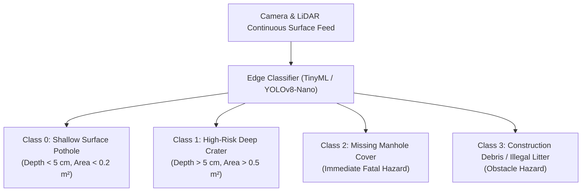
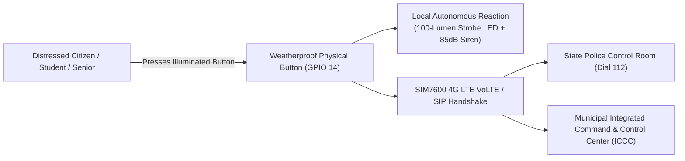

# 🚜 Eco Guardian: Municipal Dispatch Engine & Civic Infrastructure

This document details the architecture, mathematical algorithms, computer vision defect classification, and real-time dispatch protocols that power Eco Guardian’s **Zomato-Style Automated Road Repair & Civic Triage Engine**.

---

## 1. Overview: The Problem with Traditional Municipal Triage

In most Indian cities, civic damage—specifically hazardous potholes, missing manhole covers, and illegal garbage dumping—follows a broken, highly bureaucratic lifecycle:

```
[Defect Forms] ──> [Weeks of Citizen Complaints] ──> [Manual Inspection Visit] ──> [Department Bureaucracy] ──> [3-4 Weeks Repair Delay]
```

This delay is lethal. Potholes cause over **150,000 fatal road accidents annually** across India, predominantly claiming two-wheeler riders. 

Eco Guardian replaces this slow human complaint chain with an **autonomous algorithmic triage pipeline**:

```
[Sentinel Detects Defect] ──> [Edge Volumetric Classification] ──> [Algorithmic Worker Matching] ──> [Instant Handheld Routing] ──> [Fixed in < 48 Hours]
```

---

## 2. Defect Detection & Edge Computer Vision

Eco Guardian sentinel nodes feature an integrated downward-angled optical camera and solid-state LiDAR sensor aimed at the road surface corridor.

### 2.1 Supported Civic Defect Classes



### 2.2 Mathematical Volumetric & Material Estimation

When a road cavity is segmented by the vision model, the solid-state LiDAR computes depth profiles across a 64-point point-cloud grid:

$$\text{Estimated Volume } (V) = \iint_{(x,y) \in \text{BBox}} \left(Z_{\text{road\_baseline}} - Z_{\text{depth}}(x, y)\right) \, dx \, dy$$

To translate this directly into actionable work orders for municipal Public Works Departments (PWD), the system computes the exact material requirements:

$$\text{Required Cold Asphalt Mix (kg)} = V \times \rho_{\text{asphalt}} \times \text{Compaction Factor } (1.15)$$

where compacted asphalt density $\rho_{\text{asphalt}} \approx 2,400\ \text{kg/m}^3$.

*Example Output*:
- **Defect**: Hazardous Crater (Dwarka Sector 1)
- **Dimensions**: $60\text{ cm} \times 45\text{ cm} \times 7\text{ cm}$ deep
- **Calculated Material**: $43.5\text{ kg}$ cold-mix asphalt, hand tamper, emulsion tack coat.

---

## 3. The Zomato-Style Dynamic Worker Dispatch Algorithm

Just as food delivery platforms like Zomato or Swiggy dynamically assign orders to the nearest delivery partner based on proximity, tool capacity, and current order status, Eco Guardian’s municipal cloud engine continuously optimizes civic work allocation.

### 3.1 Scoring Function for Municipal Worker Selection

For a detected defect $D_i$ at GPS coordinates $(lat_d, lon_d)$ requiring tool set $T_{req}$ and material weight $M_{req}$, every active municipal worker $W_j$ in the municipal database is scored:

$$\text{Dispatch Score } (S_j) = w_1 \cdot \frac{1}{1 + \text{Dist}(D_i, W_j)} + w_2 \cdot \text{CapacityMatch}(W_j, T_{req}, M_{req}) + w_3 \cdot \text{WorkloadFactor}(W_j)$$

where:
1. $\text{Dist}(D_i, W_j)$ is the geodesic distance computed via the Haversine formula:
   $$d = 2R \arcsin\left(\sqrt{\sin^2\left(\frac{\Delta \phi}{2}\right) + \cos(\phi_1)\cos(\phi_2)\sin^2\left(\frac{\Delta \lambda}{2}\right)}\right)$$
2. $\text{CapacityMatch} \in \{0, 1\}$ evaluates if worker $W_j$’s maintenance vehicle is carrying the necessary cold mix, asphalt tamper, or replacement manhole cover slab.
3. $\text{WorkloadFactor} = \frac{1}{1 + \text{ActiveTasks}_j}$ prioritizes workers who are currently idle or finishing their final task in an adjacent sector.

### 3.2 Dwarka Pilot Simulation Walkthrough

```text
================================================================================
EVENT LOG: DWARKA MUNICIPAL CORRIDOR DISPATCH SIMULATION
================================================================================
[10:14:02.18] Node EG-DEL-DW-001 (Dwarka Sector 1) detects road defect.
              Classification: HIGH-RISK CRATER (Depth 6.8 cm, Area 0.38 m²).
              Estimated Repair Material: 38.0 kg Cold Asphalt Patch.
              Urgency Level: TIER 1 PRIORITY (Two-wheeler accident hazard).

[10:14:03.04] Central Municipal Engine executes worker proximity query.
              Querying Active PWD Crews in South-West Delhi Zone...
              • Crew 104 (Sector 7): 4.2 km away, 3 active tasks (Score: 0.28)
              • Crew 102 (Sector 9): 5.1 km away, Idle (Score: 0.42)
              • Crew 108 (Sector 2): 0.8 km away, Completing Task #412 (Score: 0.94)

[10:14:04.12] DISPATCH CONFIRMED: Assigned to Crew 108 (Worker: Ramesh K.).
              Pushing work order to mobile PWD terminal via encrypted MQTT.
              Work order contains:
              - Target GPS: 28.5921° N, 77.0460° E (Dwarka Sector 1)
              - Required Materials: 40 kg Cold Mix Asphalt + Bitumen Emulsion
              - Target SLA: Under 24 Hours.

[10:14:05.00] Node EG-DEL-DW-001 logs ticket ID #PWD-DW-2026-8941 to database.
================================================================================
```

---

## 4. Physical 24/7 Citizen SOS Emergency System

Beyond environmental and road monitoring, every Eco Guardian sentinel node serves as a physical **public safety beacon**.



### 4.1 Safety Architecture Details
1. **Zero Smartphone Requirement**: Victims of street harassment, medical emergencies, or road crashes do not need to unlock a phone, launch an app, or find mobile signal. A single physical press triggers the system.
2. **Immediate Local Deterrent**: An ultra-bright 100-lumen strobe LED ring and an 85 dB audible siren activate instantly on the pole to deter attackers and attract bystander attention.
3. **Encrypted Emergency Voice-Video Link**: The node initiates a priority SIP VoIP voice call directly to the nearest Police Control Room (Dial 112) while transmitting exact pole GPS coordinates.
4. **Resilient Off-Grid Power**: Because the node operates on an independent solar and $\text{LiFePO}_4$ battery system, the emergency SOS system remains functional even during city-wide electrical grid failures or blackouts.
