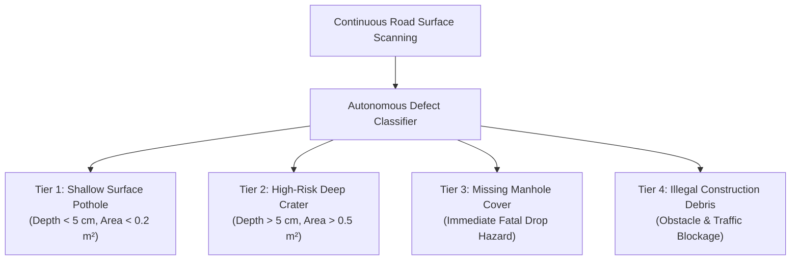
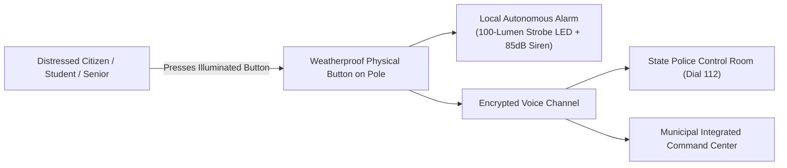

# 🚜 Eco Guardian: Municipal Dispatch Engine & Civic Infrastructure

> ### स्वस्ति पन्थामनु चरेम सूर्याचन्द्रमसाविव ।<br/>पुनर्ददताघ्नता जानता संगमेमहि ॥
> *svasti panthāmanu carema sūryācandramasāviva |<br/>punardadatāghnatā jānatā saṁgamemahi ||*
> 
> — **ऋग्वेद (Rigveda 5.51.15)**
> 
> *"May we walk upon auspicious and safe paths, unhindered and radiant like the Sun and the Moon; walking with those who are selfless, non-injuring, and full of wisdom."*

---

## 1. Overview: The Lethal Road Paradigm

In Indian cities, road defects—specifically deep potholes, collapsed manhole covers, and uncollected debris—represent an urgent public safety crisis:

```
[Defect Forms on Road] ──> [Weeks of Citizen Complaints] ──> [Manual Bureaucratic Inspection] ──> [3-4 Weeks Repair Delay]
```

This prolonged delay causes over **150,000 fatal road crashes annually**, with two-wheeler riders, cyclists, and pedestrians bearing the brunt of the casualties.

Eco Guardian replaces this slow complaint loop with an **autonomous algorithmic triage pipeline**:

```
[Sentinel Detects Defect] ──> [Volumetric Classification] ──> [Dynamic Proximity Matching] ──> [Instant Worker Dispatch] ──> [Fixed in < 48 Hours]
```

---

## 2. Defect Classification & Volumetric Estimation

Each Eco Guardian sentinel node features an integrated downward-angled optical sensor and solid-state LiDAR pointed along the road corridor.



### Volumetric & Material Estimation
When a road defect is detected, LiDAR depth vectors compute the cross-sectional dimensional profile:
1. The system calculates the estimated void volume based on baseline road surface topography.
2. It automatically computes the exact mass of **cold asphalt mix (in kg)**, tack coat emulsion, and compaction tools required for permanent restoration.
3. This eliminates guess-work for municipal teams, ensuring repair crews arrive with the exact materials needed on the very first trip.

---

## 3. The Zomato-Style Dynamic Dispatch Algorithm

Just as food delivery platforms like Zomato or Swiggy dynamically assign delivery orders to the nearest available rider based on location, vehicle type, and current delivery status, Eco Guardian’s municipal dispatch engine optimizes civic road maintenance.

### 3.1 Proximity & Capability Scoring

When a road hazard is confirmed, the central engine scores all active municipal PWD maintenance crews within the zone based on three criteria:

1. **Geodesic Distance**: Distance between the defect coordinates and the crew’s current location (computed via standard spherical distance formulas).
2. **Material & Tool Capacity**: Whether the maintenance vehicle is currently loaded with the required asphalt volume, hand tamper, or replacement slab.
3. **Current Workload**: Prioritizing crews that are currently available or nearing completion of an existing task in an adjacent sector.

### 3.2 Dwarka Pilot Simulation (Delhi)

```
================================================================================
EVENT LOG: DWARKA MUNICIPAL CORRIDOR DISPATCH SIMULATION
================================================================================
[10:14:02] Node EG-DEL-DW-001 (Dwarka Sector 1) detects road defect.
           Classification: HIGH-RISK CRATER (Depth 6.8 cm, Area 0.38 m²).
           Estimated Repair Material: 38.0 kg Cold Asphalt Patch.
           Urgency Level: TIER 1 PRIORITY (Immediate two-wheeler hazard).

[10:14:03] Municipal Central Engine queries active maintenance crews.
           Evaluating active PWD field teams in South-West Delhi...
           • Crew 104 (Sector 7): 4.2 km away, 3 active tasks (Score: 0.28)
           • Crew 102 (Sector 9): 5.1 km away, Idle (Score: 0.42)
           • Crew 108 (Sector 2): 0.8 km away, Completing Task #412 (Score: 0.94)

[10:14:04] DISPATCH CONFIRMED: Assigned to Crew 108 (Worker: Ramesh K.).
           Work order transmitted to handheld field terminal:
           - Target GPS: Dwarka Sector 1 Main Arterial Road
           - Required Materials: 40 kg Cold Mix Asphalt + Bitumen Emulsion
           - Guaranteed Resolution SLA: Under 24 Hours.

[10:14:05] Ticket #PWD-DW-2026-8941 logged. Pothole scheduled for same-day repair.
================================================================================
```

---

## 4. Physical 24/7 Citizen SOS Emergency System

Beyond environmental and road surveillance, every Eco Guardian pole acts as an active **community safety beacon**:



- **Zero Smartphone Barrier**: A victim of harassment, a senior suffering a health emergency, or a crash victim does not need to unlock a phone, open an app, or find mobile network coverage.
- **Immediate Deterrence**: Pressing the button instantly fires a flashing 100-lumen strobe ring and sounding siren to deter attackers and alert passersby.
- **Dedicated Emergency Channel**: The node initiates a direct two-way audio link to Police Control (Dial 112) while transmitting the node’s exact pole ID and GPS location.
- **Blackout-Proof**: Because the node operates on an independent solar and battery reserve, citizen emergency calls remain functional even during complete municipal power grid failure.
