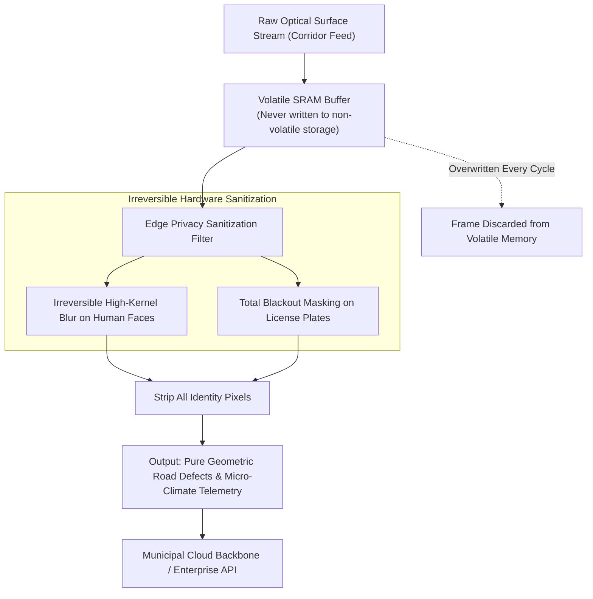

# 🔒 Eco Guardian: DPDT Act 2023 Compliance & Edge Privacy Architecture

> ### मा हिंसीः पृथिवीं न चान्तरिक्षम् ।<br/>मा च वायुं शुचिमग्निं प्रहर्षीः ॥
> *mā hiṁsīḥ pṛthivīṁ na cāntarikṣam |<br/>mā ca vāyuṁ śucimagniṁ praharṣīḥ ||*
> 
> — **यजुर्वेद (Yajurveda, Sukta 16.3)**
> 
> *"Cause no harm to the sacred Earth; violate not the vast atmosphere; do no injury to the pure Wind, nor desecrate the holy Fire. Live in sacred reverence of all life."*

---

## 1. The Legal Reality: The Privacy Peril of Smart Cities

Traditional Smart City projects often deploy thousands of high-definition CCTV cameras continuously streaming public video to centralized municipal command centers. Under Bharat's **Digital Personal Data Protection Act 2023 (DPDT Act)**:

1. **Section 4 & Section 6**: Require explicit consent and transparent purpose limitation whenever Personal Identifiable Information (PII) is gathered or processed.
2. **Citizen Facial Data & Vehicle Registration**: Citizen faces and vehicle license plates constitute personal biometric and identifying data. Storing, transmitting, or commercializing un-anonymized public video feeds creates immense privacy liabilities with penalties reaching up to **₹250 Crores per breach**.
3. **Citizen Mistrust**: Public communities resist municipal sensing grids when they feel subjected to warrantless mass surveillance.

---

## 2. The Eco Guardian Edge Privacy Guarantee: Privacy by Design

Eco Guardian operates on a strict **Zero-Surveillance, Pure-Macro-Data** architecture. No raw video feed of citizens or vehicles ever leaves the local volatile memory of the node.



---

## 3. Principles of the Edge Privacy Architecture

1. **Volatile Memory DMA Processing**: The optical sensor streams frames directly into an isolated volatile memory buffer. No frames are ever committed to permanent storage (Flash, eMMC, or SD card).
2. **Sub-66 Millisecond Processing Cycle**:
   - The frame is ingested into volatile memory.
   - Neural face and license plate detectors identify regions of interest.
   - Irreversible mathematical blurring and blackout masks are applied immediately.
   - Pothole geometry is extracted.
   - The original raw frame is completely purged and overwritten within 66 milliseconds.
3. **Irreversibility of Blurring**: Rather than superficial software overlays, high-kernel mathematical convolution destroys high-frequency biometric details irreversibly. Reconstruction of the original face or license plate is mathematically impossible.

---

## 4. Statutory Compliance with DPDT Act 2023

| DPDT Act 2023 Provision | Statutory Mandate | Eco Guardian Technical Enforcement |
| :--- | :--- | :--- |
| **Section 3(2) (Exclusions)** | Non-applicability of Act to anonymized datasets | All ingested frames are irreversibly anonymized at the edge. Datasets published to cloud APIs contain zero personal data. |
| **Section 4 (Lawful Processing)** | Data processing limited to specified lawful purpose | System processes visual data solely for road surface crack/pothole geometry and pedestrian density counts. |
| **Section 8 (Data Security)** | Reasonable security safeguards to prevent data breaches | Encrypted transport, hardware secure boot, flash encryption, and disabled physical debugging interfaces. |
| **Section 9 (Child Safety)** | Strict prohibition on tracking, behavioral monitoring, or profiling of children | Zero tracking of individuals outside schools. Only aggregate particulate levels and localized mist purification are executed. |
| **Section 27 (Penalties)** | Up to ₹250 Cr fine for failure to prevent personal data breaches | Because no PII is stored or transmitted, breach risk of personal data is mathematically eliminated at the edge. |

---

## 5. Legality of Environmental Data Monetization

Because all data streams exiting the Eco Guardian sentinel grid are **100% anonymized environmental and civic telemetry**, they are legally classified as **Non-Personal Data (NPD)** under Indian law.

This enables Eco Guardian to lawfully monetize environmental intelligence without privacy infringements:

```
+-------------------------------------------------------------------------+
|                  ECO GUARDIAN DPDT-COMPLIANT DATA STREAM                |
+-------------------------------------------------------------------------+
|  ✔ ALLOWED & MONETIZED:                                                 |
|    • Hyper-local PM2.5, PM10, VOC, and Ammonia concentrations (ppm)     |
|    • Street-level ambient temperature, relative humidity & pressure      |
|    • Road surface roughness index (IRI) & defect dimensional coordinates|
|    • Solar irradiance (W/m²) and localized rainfall precipitation logs  |
|                                                                         |
|  ❌ STRICTLY DESTROYED AT HARDWARE LEVEL:                               |
|    • Citizen facial biometric profiles                                  |
|    • Vehicle registration / license plate numbers                       |
|    • Individual pedestrian walking trajectories or dwell times          |
+-------------------------------------------------------------------------+
```

This verified legal separation forms the foundation of Eco Guardian’s primary revenue stream: licensing high-value micro-climate and road condition intelligence to commercial EV networks, health platforms, and logistics corporations.
