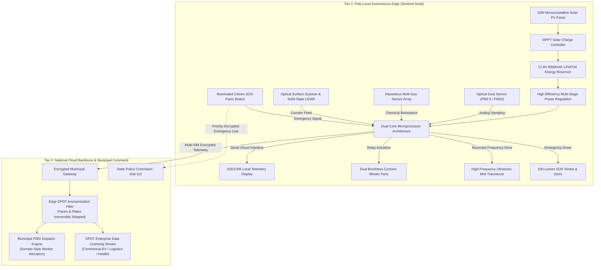

# ⚙️ Eco Guardian: System Architecture & Hardware Specification

> ### नमस्ते वायो । त्वमेव प्रत्यक्षं ब्रह्मासि ।<br/>त्वामेव प्रत्यक्षं ब्रह्म वदिष्यामि । ऋतं वदिष्यामि । सत्यं वदिष्यामि ॥
> *namaste vāyo | tvameva pratyakṣaṁ brahmāsi |<br/>tvāmeva pratyakṣaṁ brahma vadiṣyāmi | ṛtaṁ vadiṣyāmi | satyaṁ vadiṣyāmi ||*
> 
> — **तैत्तिरीयोपनिषद् (Taittiriya Upanishad, Shikshavalli 1.1)**
> 
> *"Salutations unto Thee, O Vāyu (Cosmic Wind)! You alone are the directly perceptible manifestation of the Supreme Reality. I shall proclaim You as the living Cosmic Law; I shall speak of You as the Ultimate Truth."*

---

## 1. High-Level Dual-Tier Edge Topology

Eco Guardian is structured around a **Dual-Tier Edge Architecture** designed to balance immediate, on-site autonomous execution with centralized municipal oversight.



---

## 2. Microprocessor Workflow & Task Distribution

The sentinel's processing unit divides critical tasks between two dedicated processing pipelines so that high-latency cellular transmissions never interrupt urgent environmental protection:

- **Pipeline Alpha (Network, Telemetry & Civic Handshake)**:
  - Manages long-range cellular transmissions, data compression, and encrypted cloud synchronization.
  - Maintains a local 72-hour historical ring buffer so no environmental or road data is lost during telecom blackouts.
  - Dispatches high-priority chemical emergency notifications across civic warning channels in sub-seconds.
  - Handles the priority emergency protocol when the physical SOS button is pressed.

- **Pipeline Beta (Real-Time Sensing & Autonomous Actuation)**:
  - Executes optical dust infrared pulse sampling at high frequency.
  - Evaluates analog gas resistance against pre-calibrated multi-point baseline curves.
  - Computes real-time mathematical Air Quality Index (AQI) values continuously.
  - Triggers brushless blowers when AQI > 100 and drives ultrasonic transducers for particulate precipitation.
  - Refreshes the local eye-level OLED display at 30 frames per second.

---

## 3. Sensory Physics & Environmental Transduction

### 3.1 Optical Particulate Ingestion
The dust sensor operates on the physical principle of **forward infrared light scattering**:
1. An internal infrared emitter emits a focused light pulse across a specialized optical detection chamber.
2. Suspended airborne particles entering the chamber scatter the beam onto a high-sensitivity photodiode detector.
3. The photodiode generates an output voltage directly proportional to the mass concentration of suspended particulates in micrograms per cubic meter ($\mu\text{g/m}^3$).
4. The signal is filtered to eliminate optical ambient noise and mapped against calibrated empirical curves.

### 3.2 Hazardous Chemical Vapor Array
The multi-gas detection array monitors toxic vapors (ammonia, volatile organic compounds, carbon monoxide) through surface oxidation-reduction reactions:
1. A heated metal-oxide semiconductor surface ($SnO_2$) adsorbs oxygen molecules from clean air, creating an electrical potential barrier.
2. When reducing toxic gases come into contact with the heated surface, they react with adsorbed oxygen ions, lowering the potential barrier and causing an instantaneous drop in electrical resistance.
3. The ratio of operating resistance to clean-air baseline resistance correlates logarithmically with gas concentration in parts per million (ppm).
4. If gas concentration exceeds safe industrial limits (> 300 ppm), the node immediately executes local alarm procedures.

---

## 4. Off-Grid Solar Energy Reservoir & Power Budget

Eco Guardian is designed for perpetual off-grid operation across Indian climatic zones:

```
+-------------------------------------------------------------------------+
|                    OFF-GRID SOLAR ENERGY FLOW                           |
+-------------------------------------------------------------------------+
|                                                                         |
|  [ 10W Monocrystalline PV Panel ] ──> [ MPPT Charge Controller ]        |
|                                                     |                   |
|                                                     v                   |
|                                      [ 12.8V 6000mAh LiFePO4 Battery ]  |
|                                                     |                   |
|          +------------------------------------------+                   |
|          |                                          |                   |
|          v                                          v                   |
|  [ Base Sensing: 0.83 W ]               [ Active Misting: 6.14 W ]      |
|  (Continuous Monitoring)                (Intermittent Trigger AQI > 100)|
|                                                                         |
+-------------------------------------------------------------------------+
```

### Key Electrical Features
- **Solar Generation**: 10W Monocrystalline PV panel angled at $28^\circ$ optimal tilt for Indian latitude.
- **Advanced Battery Chemistry**: $\text{LiFePO}_4$ (Lithium Iron Phosphate) cells deliver over 3,000 thermal charge cycles without degradation, operating safely up to $60^\circ\text{C}$ without thermal runaway risks.
- **72-Hour Autonomy**: The 76.8 Wh battery buffer provides more than 3 continuous days of autonomous operation during heavy winter smog, persistent fog, or monsoon rains with zero sunlight.
